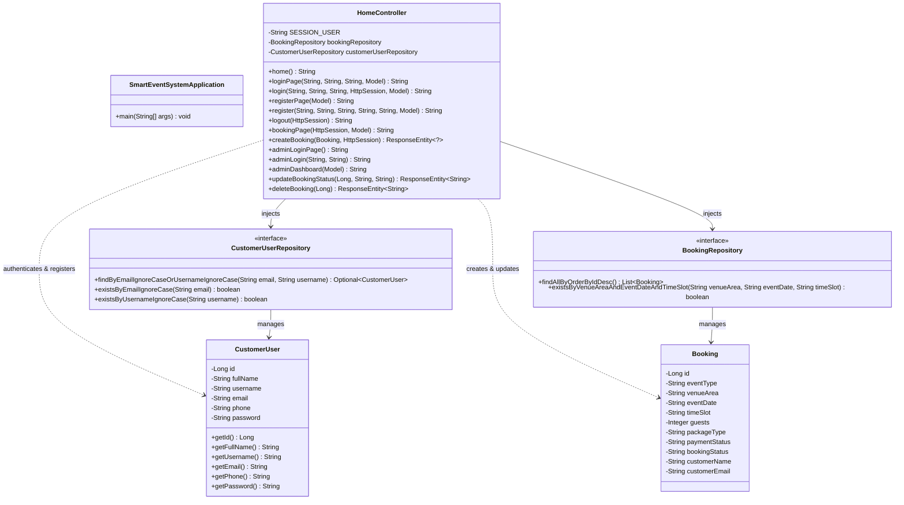

# Smart Event Booking System — CED EVENT & CATERING MANAGEMENT

> **"Plan • Book • Celebrate — Turn your special moments into unforgettable memories."**

## Project Overview

**Smart Event Booking System** (branded as **CED EVENT & CATERING MANAGEMENT**) is a web-based event reservation and management application built with **Java**, **Spring Boot**, **Thymeleaf**, **HTML**, **CSS**, **JavaScript**, and **MySQL** (`golden_moments_db`) using Spring Data JPA / Hibernate. It provides a landing page (`/`), session-protected customer authentication (`/login`, `/register`, `/logout`), an interactive event booking interface (`/booking`) with duplicate venue/date/time-slot conflict checking and booking status tracking, and an administrative workflow (`/admin`, `/admin/login`, `/admin/dashboard`, `/admin/bookings/update`, `/admin/bookings/delete`).

---

## Project Features

* **Home Page (`/`)**: Renders `index.html` presenting CED EVENT & CATERING MANAGEMENT with navigation to *Home*, *About*, *Events*, *Admin*, and *Log In*, an *Explore Our Events* call-to-action, and feature highlights (*Easy Booking*, *Memorable Events*, *Trusted Service*).
* **Customer Registration (`/register`)**: Validates required fields (`fullName`, `email`, `phone`, `password`, and optional `username`), prevents duplicate email addresses or usernames against the `users` table (`existsByEmailIgnoreCase` and `existsByUsernameIgnoreCase`), persists a new `CustomerUser` record to MySQL, and redirects to `/login?registered=true`.
* **Customer Login & Session Protection (`/login` & `/logout`)**: Authenticates users by matching email or username (case-insensitive) and password via `CustomerUserRepository.findByEmailIgnoreCaseOrUsernameIgnoreCase`, stores session attributes (`loggedInUser`, `loggedInUserName`, `loggedInUserId`) in `HttpSession`, redirects unauthenticated `/booking` visits to `/login`, and invalidates the session on `/logout`.
* **Event Booking & Conflict Validation (`/booking` & `POST /api/bookings`)**: Renders `booking.html` for authenticated sessions with existing bookings ordered by ID descending (`findAllByOrderByIdDesc`), and exposes `POST /api/bookings` to verify session authentication (`401 Unauthorized`), reject overlapping reservations sharing `venueArea`, `eventDate`, and `timeSlot` (`409 Conflict`), apply default `Unpaid` payment status and `Pending` booking status, and save new `Booking` records (`201 Created`).
* **Admin Portal & Dashboard (`/admin`, `/admin/login`, `/admin/dashboard`)**: Renders `admin.html` and `admin-dashboard.html`, supporting status transitions (`POST /admin/bookings/update` for `paymentStatus` and `bookingStatus`) and booking removal (`POST /admin/bookings/delete`).

---

## OOP Principles Applied

* **Encapsulation**: Domain models and controllers bundle state and behavior while restricting direct field access. `HomeController.CustomerUser` declares private fields (`id`, `fullName`, `username`, `email`, `phone`, `password`) with public getters and setters, `Booking` encapsulates reservation attributes with getters and setters, and `HomeController` encapsulates session attribute keys (`SESSION_USER`), credential checks, and request routing.
* **Inheritance**: Data access interfaces extend Spring Data JPA's `JpaRepository` interface to inherit standard persistence operations (`save`, `findAll`, `findById`, `existsById`, `deleteById`) while defining custom query methods. `CustomerUserRepository` extends `JpaRepository<HomeController.CustomerUser, Long>` and `BookingRepository` extends `JpaRepository<Booking, Long>`.
* **Polymorphism**: Methods and HTTP endpoints handle varied runtime inputs and response types through common types and interfaces. `HomeController.createBooking` returns `ResponseEntity<?>` so it can return `ResponseEntity.status(HttpStatus.UNAUTHORIZED)`, `ResponseEntity.status(HttpStatus.CONFLICT)`, or `ResponseEntity.status(HttpStatus.CREATED)` depending on session and conflict state, while `Optional<HomeController.CustomerUser>` and `List<Booking>` represent query outcomes uniformly.
* **Abstraction**: Spring Boot, Spring Data JPA, and Thymeleaf hide low-level JDBC connection pooling, SQL generation, HTTP session handling, and view rendering behind high-level interfaces and controller methods. `CustomerUserRepository` and `BookingRepository` declare query signatures (`findByEmailIgnoreCaseOrUsernameIgnoreCase`, `existsByEmailIgnoreCase`, `existsByUsernameIgnoreCase`, `findAllByOrderByIdDesc`, `existsByVenueAreaAndEventDateAndTimeSlot`) without manual SQL implementations.

---

## Project Structure (Folder Structure)

### Folder Structure

```text
smart-event-system/
└── smart-event-system/
    ├── pom.xml
    ├── mvnw
    ├── mvnw.cmd
    └── src/
        ├── main/
        │   ├── java/
        │   │   └── com/
        │   │       └── smartevent/
        │   │           ├── SmartEventSystemApplication.java
        │   │           ├── HomeController.java
        │   │           ├── Booking.java
        │   │           ├── BookingRepository.java
        │   │           └── CustomerUserRepository.java
        │   └── resources/
        │       ├── application.properties
        │       ├── static/
        │       │   ├── style.css
        │       │   └── script.js
        │       └── templates/
        │           ├── index.html
        │           ├── booking.html
        │           ├── admin.html
        │           └── admin-dashboard.html
        └── test/

```

### UML Class Diagram



---

## How to Run the Program

1. **Start MySQL and Verify Configuration**
Ensure MySQL is running on `localhost:3306` with the `golden_moments_db` database configured in `src/main/resources/application.properties`.
2. **Navigate to the Maven Project Directory**
Open PowerShell and change into the inner project directory containing `mvnw.cmd` and `pom.xml`:
```powershell
cd "C:\Users\erikk\Downloads\smart-event-system\smart-event-system"

```


3. **Clear Port `8081` (If Needed) and Start Spring Boot**
Run the following commands to stop any existing process on port `8081` and start the application:
```powershell
Get-NetTCPConnection -LocalPort 8081 -ErrorAction SilentlyContinue | Select-Object -ExpandProperty OwningProcess -Unique | ForEach-Object { Stop-Process -Id $_ -Force }
.\mvnw.cmd clean spring-boot:run

```


4. **Open in Browser**
Visit **`http://localhost:8081`** to browse the Home Page (`/`), sign up or log in (`/register`, `/login`), access `/booking`, log out (`/logout`), or open `/admin` for the admin dashboard.

---

## Sample Screenshots/Output/Highlights

> *Add actual screenshot files to the repository (for example under `screenshots/`) and replace the placeholders below before final submission.*

* **Home Page (`/`)**: Displays the landing page (`index.html`) for CED EVENT & CATERING MANAGEMENT with navigation links and event service highlights. *(Screenshot to be added: `[Add Home Page screenshot path]`)*
* **Login & Registration (`/login` & `/register`)**: Displays the authentication and registration interface in `booking.html` when unauthenticated, including registration validation, duplicate email/username checks, and login error/success alerts. *(Screenshot to be added: `[Add Login/Registration screenshot path]`)*
* **Booking Page (`/booking`)**: Displays the authenticated booking form and reservation list (`booking.html`), including venue area, event date, time slot, guest count, package selection, duplicate slot conflict responses (`409 Conflict`), and logout action (`/logout`). *(Screenshot to be added: `[Add Booking Page screenshot path]`)*
* **Admin Dashboard (`/admin` & `/admin/dashboard`)**: Displays `admin.html` and `admin-dashboard.html` for viewing bookings, updating `paymentStatus` and `bookingStatus`, and deleting records. *(Screenshot to be added: `[Add Admin Dashboard screenshot path]`)*
* **Console Startup Output**:
```text
Tomcat initialized with port 8081 (http)
HikariPool-1 - Start completed.
Tomcat started on port 8081 (http) with context path '/'
Started SmartEventSystemApplication

```


---

## Thank You Message

Thank you for exploring the **Smart Event Booking System (CED EVENT & CATERING MANAGEMENT)**. We appreciate your time in reviewing our application and hope it demonstrates practical object-oriented design and web application integration.

---

## Team Members

* Dela Roca, Erikka Stephanie A.


* Malabanan, Ma. Divine Grace D.


* Plantilla, John Carlo M.


* Velasco, Bless R.


---

## Acknowledgement

We extend our sincere gratitude to our instructor for the guidance, feedback, and support throughout this course, as well as to our teammates and everyone who helped us build, test, and refine this project.
